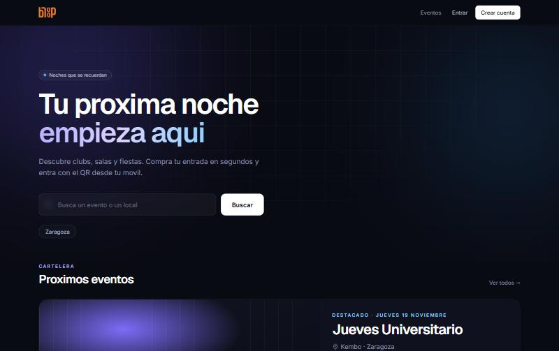
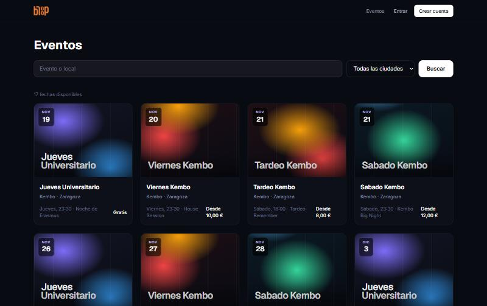
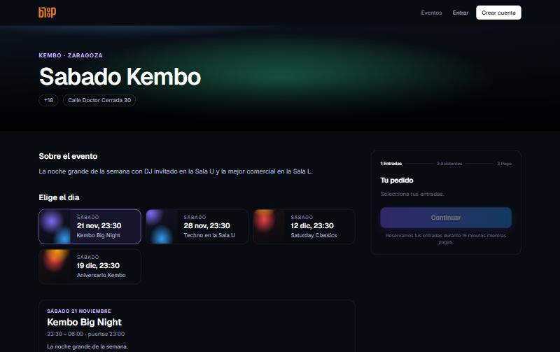
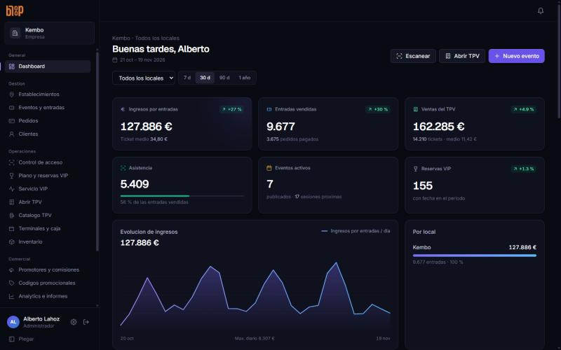
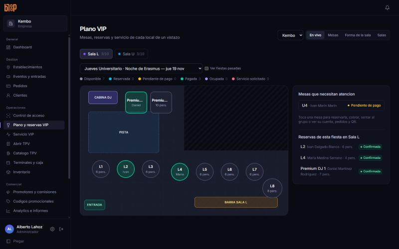
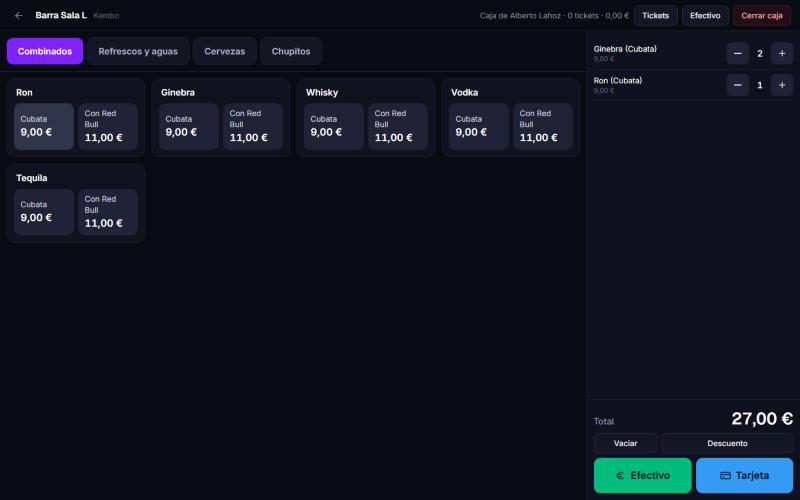
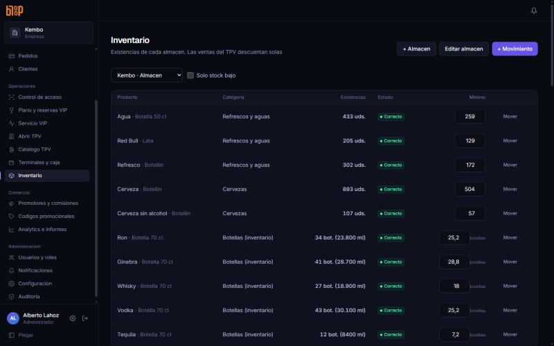
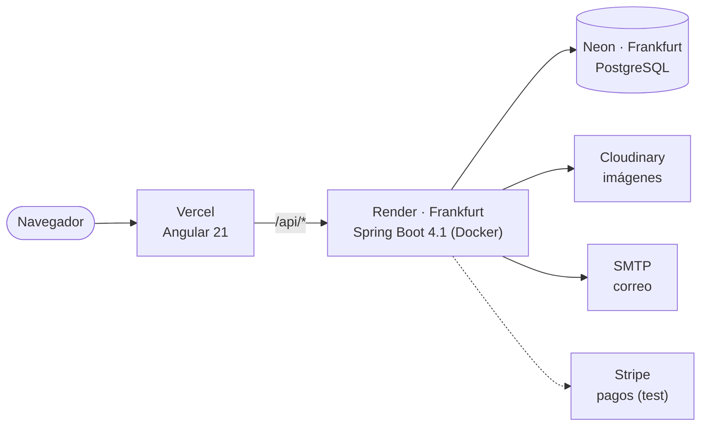

<p align="center">
  
</p>

<h3 align="center">La plataforma todo en uno para discotecas y salas de ocio nocturno</h3>

<p align="center">
  Venta de entradas · Control de acceso con QR · Reservados VIP · TPV de barra · Inventario · Analítica
</p>

<p align="center">
  <a href="https://bloop-v1.vercel.app"><b>🚀 Ver la demo en vivo</b></a> ·
  <a href="#-prueba-la-demo">Cuentas de prueba</a> ·
  <a href="#-capturas">Capturas</a> ·
  <a href="#️-arquitectura">Arquitectura</a>
</p>

<p align="center">
  
  
  
  
  
  
  
</p>

---

## ✨ Qué es Bloop

Una discoteca suele trabajar con herramientas que no se hablan entre sí: una web para vender entradas, una app
para leer QR en la puerta, una libreta para los reservados, un TPV en la barra y un Excel para el inventario.
Al final de la noche nadie sabe con certeza cuánto se ha vendido, quién ha entrado o cuánta bebida se ha perdido.

**Bloop une todo eso en una sola aplicación web multiempresa.** Cada empresa y cada local ven solo sus datos, y
cada persona del equipo trabaja con su rol: administrador, encargado, caja, puerta, camarero VIP o relaciones
públicas. Los clientes, por su parte, compran sus entradas nominales y reservan mesa desde la web pública.

## 🎮 Prueba la demo

**👉 [bloop-v1.vercel.app](https://bloop-v1.vercel.app)**

La demo muestra **Kembo**, una discoteca ficticia de Zaragoza con dos salas (con forma de L y de U), 20 reservados,
tres meses de actividad simulada (fiestas, entradas, ventas de barra, reservas, inventario) y el mes siguiente
con fiestas a la venta. Todas las personas, pedidos y ventas son **datos inventados** generados para la demo.

Contraseña de todas las cuentas: **`Demo1234!`**

| Cuenta | Qué puedes ver |
|---|---|
| `admin@kembo.test` | Todo el backoffice: panel, eventos, plano VIP, TPV, inventario, analítica, usuarios |
| `encargado@kembo.test` | Gestión diaria del local |
| `caja@kembo.test` | TPV de barra |
| `puerta@kembo.test` | Control de acceso con QR |
| `servicio@kembo.test` | Servicio de mesas VIP |
| `cliente@kembo.test` | La web pública como cliente: entradas, pedidos y reservas |

> ⏳ El backend está en un plan gratuito que se suspende tras un rato sin visitas: **la primera carga puede tardar
> unos 50 segundos** mientras se despierta. Después va rápido.
>
> Es una demo pública y compartida: cualquiera puede modificar los datos. Si se estropean, se vuelven a cargar.

## 📸 Capturas

<p align="center">
  
</p>

<table>
  <tr>
    <td width="50%"><p align="center"><b>Cartelera pública</b> con carteles generados para cada fiesta</p></td>
    <td width="50%"><p align="center"><b>Ficha del evento</b>: días, tipos de entrada y compra nominal</p></td>
  </tr>
  <tr>
    <td width="50%"><p align="center"><b>Panel</b>: ingresos, entradas, TPV, asistencia y reservas</p></td>
    <td width="50%"><p align="center"><b>Plano VIP</b>: cada sala con su forma y el estado de cada mesa en la fiesta</p></td>
  </tr>
  <tr>
    <td width="50%"><p align="center"><b>TPV de barra</b>, con recetas en ml por combinado</p></td>
    <td width="50%"><p align="center"><b>Inventario</b> por almacén y barra, con mínimos y avisos</p></td>
  </tr>
</table>

## 🧩 Funcionalidades

**Web pública para clientes**
- Cartelera de eventos y locales, con buscador y filtro por ciudad.
- Compra de **entradas nominales**: datos de cada asistente, control de edad mínima y códigos promocionales.
- Pago con **Stripe** (modo test), confirmado solo mediante webhook firmado; pago simulado en desarrollo.
- Área de cliente: entradas con **QR**, transferir una entrada a otra cuenta, pedidos, reservas y privacidad (RGPD).
- Carta del reservado por **QR de mesa**: el grupo pide desde el móvil.

**Backoffice del personal**
- **Eventos** con varios días (sesiones), cartel propio por día, tipos de entrada, cupos, pausa de ventas y
  cancelación con reembolso automático.
- **Control de acceso**: validación de QR en la puerta; cada QR solo vale una vez.
- **Reservados VIP**: cada sala con su plano dibujado, reservas por fiesta, paquetes de botellas, venta en
  taquilla, pedidos de mesa, cobro y cierre de cuenta.
- **TPV** de barra y taquilla: cajas con fondo y arqueo, combinados con receta en ml, anulaciones y descuentos autorizados.
- **Inventario de discoteca**: proveedores, entradas con albarán y coste, traspasos almacén → barra, recuento de
  cierre, control de merma, pedido sugerido y envases retornables.
- **Comercial**: relaciones públicas con comisión, códigos promocionales y CRM de clientes con consentimientos.
- **Analítica**: panel de indicadores, informes, exportación CSV, previsión de asistencia y alertas.
- **Correo** transaccional con plantillas HTML (entradas, reservas, recuperación de contraseña) e **imágenes** en Cloudinary.
- Auditoría de acciones, usuarios, roles y permisos.

## 🏗️ Arquitectura



- **Monolito modular**: un único backend organizado por módulos de negocio (eventos, pedidos, accesos, reservas,
  TPV, inventario...). Cada módulo sigue la misma estructura: `controller`, `dto`, `entity`, `repository`, `service` y `mapper`.
- El frontend llama siempre a `/api` en su mismo dominio y **Vercel reenvía esas peticiones al backend**; así la
  cookie de sesión funciona sin problemas de CORS.
- Backend y base de datos están en la **misma región (Frankfurt)**, cerca de los usuarios.

## 🔍 Aspectos técnicos destacados

- **Multiempresa real**: la empresa sale siempre del usuario autenticado y todas las consultas filtran por ella;
  pedir un recurso de otra empresa devuelve 404.
- **Concurrencia sin sobreventa**: el cupo de entradas se descuenta con `UPDATE` condicional, cada QR se marca como
  usado de forma atómica y las reservas no pueden solaparse gracias a una restricción `EXCLUDE USING gist` de PostgreSQL.
- **Idempotencia**: ventas del TPV, pedidos y cobros de mesa llevan clave de idempotencia; un doble clic no cobra dos veces.
- **Seguridad**: JWT de acceso + refresh token en cookie `HttpOnly` y `SameSite=Strict`, bloqueo temporal tras
  intentos fallidos, rotación de claves y permisos por rol. No se guardan datos de tarjeta, y del documento de
  identidad solo el tipo y los 4 últimos caracteres.
- **Esquema versionado** con Flyway (17 migraciones) y validación del modelo al arrancar.
- **Pruebas**: 93 tests de backend contra un **PostgreSQL embebido real** (sin simular la base de datos) y 37 tests de
  frontend con Vitest. Integración continua con GitHub Actions.

## 🛠️ Tecnologías

| Capa | Tecnología |
|---|---|
| Backend | Java 21, Spring Boot 4.1 (Web MVC, Security, OAuth2 Resource Server/JWT, Data JPA, Validation, Mail, Actuator), Flyway, springdoc-openapi |
| Base de datos | PostgreSQL (17 en local con PostgreSQL embebido, 18 en Neon) |
| Frontend | Angular 21 (componentes standalone y signals), TypeScript 5.9, Tailwind CSS 4 |
| Pruebas | JUnit 5, PostgreSQL embebido, GreenMail, Vitest |
| Servicios | Stripe (modo test), Cloudinary, SMTP (Gmail) |
| Despliegue | Vercel (frontend), Render con Docker (backend), Neon (PostgreSQL), GitHub Actions (CI) |

## 📁 Estructura

```
├── backend/                  API REST Spring Boot (monolito modular)
│   ├── src/main/java/com/bloop/
│   │   ├── authentication/   login, JWT, registro, recuperación de contraseña
│   │   ├── events/ orders/ payments/ ticketing/ accesscontrol/
│   │   ├── reservations/ vipservice/         reservados VIP y servicio de mesa
│   │   ├── pos/ inventory/                   TPV e inventario
│   │   ├── promoters/ customers/ analytics/ dashboard/ audit/ notifications/ media/
│   │   ├── tenants/ venues/ users/ shared/
│   │   └── demo/                             datos de demostración (Kembo)
│   ├── src/main/resources/db/migration/     migraciones Flyway V1…V17
│   └── Dockerfile
├── frontend/                 Angular 21
│   ├── src/app/public/       web pública para clientes
│   ├── src/app/features/     backoffice del personal
│   └── vercel.json           despliegue en Vercel
├── render.yaml               despliegue del backend en Render
├── docker-compose.yml        PostgreSQL + Mailpit en local (opcional)
└── .env.example              plantilla de variables de entorno (sin secretos)
```

## 💻 Ejecutar en local

**Requisitos:** JDK 21 o superior y Node.js 22. No hace falta instalar Maven (se usa `mvnw`) ni PostgreSQL (se usa uno embebido).

```bash
git clone https://github.com/Juaan20/Bloop_v1.git
cd Bloop_v1
cp .env.example .env            # en Windows: copy .env.example .env

# Backend: http://localhost:8080 (Swagger en /swagger-ui.html)
cd backend
./mvnw spring-boot:test-run     # Windows: mvnw.cmd spring-boot:test-run

# Frontend: http://localhost:4200
cd ../frontend
npm install
npm start
```

- La primera vez se crea la base de datos local (`backend/.local-db`) con los datos de demostración de Kembo.
- En Windows, `start-dev.bat` arranca las dos partes y `stop-dev.bat` las para (incluido PostgreSQL).
- Pruebas: `cd backend && ./mvnw test` y `cd frontend && npx ng build && npm test`.

## ⚙️ Variables de entorno

En local se leen del fichero `.env` (plantilla en `.env.example`). En producción se configuran en el panel de
cada servicio y **nunca se suben al repositorio**.

| Variable | Para qué sirve |
|---|---|
| `SPRING_PROFILES_ACTIVE` | `dev` en local, `prod` en producción |
| `DB_URL`, `DB_USERNAME`, `DB_PASSWORD` | Conexión a PostgreSQL (en local no hacen falta con el embebido) |
| `JWT_SECRET`, `QR_SECRET` | Firma de sesiones y de los QR (mínimo 32 caracteres) |
| `PUBLIC_URL`, `CORS_ALLOWED_ORIGINS` | URL pública del frontend (enlaces de los correos, vuelta de Stripe) |
| `MAIL_ENABLED`, `MAIL_HOST`, `MAIL_PORT`, `MAIL_USERNAME`, `MAIL_PASSWORD`, `MAIL_FROM`... | Correo SMTP. Con `MAIL_ENABLED=false` los correos solo se guardan y se escriben en el log |
| `MEDIA_PROVIDER`, `MEDIA_CLOUDINARY_*` | Imágenes en disco local o en Cloudinary |
| `STRIPE_ENABLED`, `STRIPE_SECRET_KEY`, `STRIPE_WEBHOOK_SECRET` | Pago con Stripe en modo test (solo claves `sk_test_`) |
| `DEMO_DATA`, `DEMO_PASSWORD`, `DEMO_DATASET` | Datos de demostración (solo perfil `dev`) |

## ☁️ Despliegue

La demo funciona con planes gratuitos:

| Pieza | Servicio | Notas |
|---|---|---|
| Frontend | **Vercel** | *Root Directory* `frontend`; `frontend/vercel.json` reenvía `/api` al backend |
| Backend | **Render** (Docker, Frankfurt) | Blueprint en `render.yaml`; solo se redespliega cuando cambia `backend/` |
| Base de datos | **Neon** (Frankfurt) | Conexión directa (sin pooler): el backend ya tiene su pool y Flyway migra al arrancar |
| Imágenes | **Cloudinary** | El disco de Render no es persistente |
| Correo | **Gmail** (SMTP) | Con contraseña de aplicación |

Pasos resumidos:
1. **Neon**: crear el proyecto y convertir la conexión directa a `DB_URL=jdbc:postgresql://HOST/neondb?sslmode=require`,
   `DB_USERNAME` y `DB_PASSWORD`.
2. **Render**: *New → Blueprint* con este repositorio y rellenar las variables marcadas como `sync: false`.
   `JWT_SECRET` y `QR_SECRET` las genera Render.
3. **Vercel**: importar el repositorio con *Root Directory* `frontend` y poner su URL en `PUBLIC_URL` y
   `CORS_ALLOWED_ORIGINS` del backend.

En producción no se crean datos de demostración automáticamente: los de esta demo se cargaron una sola vez con
los generadores del perfil `dev` apuntando a la base de datos de Neon.

## 👤 Autor

Proyecto desarrollado por **[Juaan20](https://github.com/Juaan20)**.

¿Te interesa el proyecto o tienes alguna sugerencia? Abre un *issue* en este repositorio.
